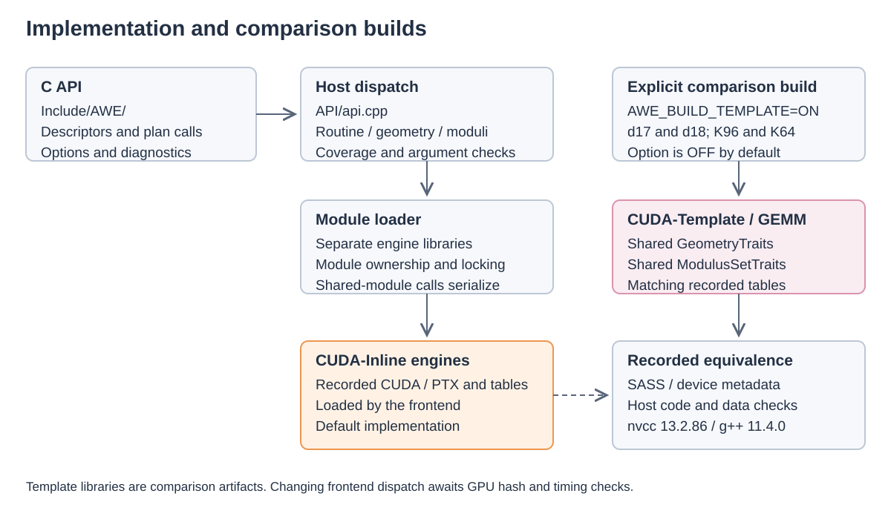

# Implementation and code comparisons

See the [repository map](../README.md#repository-structure) for directory roles
and the [build guide](build.md#engine-loading-and-isolation) for module loading.

## Inline and Template

The shared source is `Platforms/NVIDIA/CUDA-Template/GEMM/Common/l8rt.cu`. Thin translation
units under `Platforms/NVIDIA/CUDA-Template/GEMM/<SM_K>/D53_M17/` and
`D53_M18/` select
`GeometryTraits` and `ModulusSetTraits` specializations. All arithmetic and launch
code then comes from the shared source.
There is no runtime geometry branch. The 2 measured scale-slot initialization
and refresh schedules remain separate `if constexpr` branches, preserving their
instruction order rather than adding an inline helper boundary.

| Geometry trait | K96 | K64 |
|---|---:|---:|
| Cut width | 96 | 64 |
| Bytes per packed tile | 6144 | 4096 |
| Bytes per group of 8 rows | 384 | 256 |
| Encoder chunks / staging rows / grid x | 12 / 23 / 6 | 8 / 32 / 4 |
| Scale slots / columns per slot | 4 / 16 | 7 / 8 |
| Tensor descriptor stride | 24 | 16 |
| MMA instruction descriptor | `0x90380480` | `0x10380480` |
| Byte residues required by d18 | Yes | No (the recorded build uses byte residues) |
| d18 stage-2 table limit | 16384 | 8192 |
| d18 legacy info K maximum | 8254 | 8192 |
| Target | `sm_103a` | `sm_100a` |

For d17, both geometries use a stage-2 table limit and legacy info K maximum of
8192. Its modulus trait does not require byte residues; the recorded build uses
them. The 2 d18-only product/plane branches are excluded from d17 with `#if`.

The table limit is not the public API's accepted K range. The frontend's coverage
and dispatch checks still apply; see [the API contract](api.md). Generated table
headers are included from the corresponding Inline source, including encoder
LUTs, sign flips, stage-2 schedules and CRT grouping. No generator or changed table
values are introduced. Preprocessor selection covers these includes, the 2
d18-only branches and literal host diagnostics that remain identical to Inline.

To build comparison libraries, configure with `-DAWE_BUILD_TEMPLATE=ON` and the
usual `AWE_BACKEND=K96` or `K64`. Build `awe_Template_k96_d17` and
`awe_Template_k96_d18` for K96, or `awe_Template_k64_d17` and
`awe_Template_k64_d18` for K64. Outputs are under `Build/Lib/Template/`; Inline
libraries remain under `Build/Lib/` with the frontend. The option defaults to OFF.
Both forms use the same recorded compiler arguments, exports and SONAME; they are
intended for separate comparison processes, not simultaneous replacement within
1 frontend process.

For each pair, run `Tools/host_text_gate.py Inline.so Template.so` and
`Tools/sass_gate.py Inline.so Template.so --ignore-kernel-names --cuobjdump /path/to/cuobjdump`.
These results describe the recorded nvcc 13.2.86 / g++ 11.4.0 build. With another
compiler, rerun both the host and device gates. The d18 validation record also
compares every ELF section, including host tables, relocation data and raw unwind
and exception tables, with only build ID and documented compiler-name exceptions.

The recorded Template d17/d18 builds for both geometries pass device comparisons
and raw host instruction checks against Inline.
[The comparison records](Provenance/README.md) include accepted and rejected
candidates. Preprocessing alone cannot compare a traits-based source with Inline:
it does not evaluate C++ traits.

## Level-3 support kernels

The original real and complex copies retain the measured adapters' launch
geometry and synchronization. Real transpose uses 32x8 threads and real lower
copy uses 4096x256; complex copies use the same geometry, with conjugation where
required. Real copies synchronize their stream; complex copies synchronize an
event. The engine then runs once on its existing stream. Original support
functions remain available for a complete device comparison, even when unused
by the public API. [The import record](Provenance/level3_support.json) and
[the later shared-copy checks](Provenance/support_copy_validation.json) distinguish
these functions from the added lower-triangle copy.

## Source and device comparisons

`Tools/sass_gate.py REFERENCE CANDIDATE` runs `cuobjdump -sass` without loading
the library or launching a kernel. It compares each function's architecture,
instruction sequence, operands, and encoded instruction/control words. It ignores
listing addresses, source locations, and file metadata. Empty or unrecognized
instruction listings fail. Function ordering is irrelevant; multiplicity is retained.
Kernel names are compared by default. The `--ignore-kernel-names` mode used for
symbol isolation and support-kernel extraction compares a multiset of complete
function bodies.

The gate is deliberately stricter than a comparison of mnemonics alone: changed
scheduling/control bits also fail. It also compares resources, ELF attributes, embedded image inventory, and device
data. The host comparisons below check host machine code. Neither
gate tests CUDA API behavior or independently validates numerical results.
The source gate checks formatting and comment changes as described below.

`Tools/replay_cuda_build.py SOURCE BUILD --arguments FLAGS.json --reference REF.so`
copies CUDA headers and translation units into a fresh build directory and compiles
with nvcc 13.2.86. FLAGS.json is an argument array taken from the recorded command,
excluding the compiler executable, output path, and intermediate-file options. All
optimization flags, definitions, architecture options, and their order are retained.
The tool saves source SHA-256 values, compiler version, arguments, build log,
intermediates, and the SASS comparison result. It never invokes a source build script.

K96 import comparisons use the corresponding measured binary built with nvcc
13.2.86. The reference must have the same patches as the imported source;
SYRK/TRMM-patched code differs from unpatched ZGEMM. Missing measured references
are identified in the import records with the measured version and build source.

The original K64 references are sm_100a builds of the selected source with nvcc
13.2.86, made before comment cleanup or formatting. Those comparisons cover
that compiler's builds. Their records contain source hashes, full flags,
compiler version and normalized SASS digests. The later
[C24 Arm comparison](Provenance/k64_cgemm_measured.json) uses its own compiler
and measured reference.

### Source tokens and device metadata

`Tools/source_tokens.py --formatting` accepts an added brace pair only when it
immediately follows an original `if`, `else`, `for`, `while`, or `do` control head
and encloses exactly its original single statement, with no preprocessor directive
between the head and statement or within that statement. Original tokens,
including original braces, remain in order. Nested control statements and
their `else` bindings are checked; arbitrary new scopes and expanded bodies fail.
The parser is conservative, not a full C++ front end. It rejects unproven macro
statement bodies; the local single-`asm` macro form used here is checked explicitly.

Both modes compare logical preprocessor lines separately, including their position
among ordinary tokens and function-like macro adjacency. Table constants, launch
arguments, PTX strings, and `using` declaration order are protected. Comment edits
use exact token equality. clang-format uses `SortUsingDeclarations: Never`.

The device gate also compares `cuobjdump -res-usage` (registers, static shared
memory, stack and local memory), `.nv.info` attributes from `-elf`, and all dumped
constant/global-init data. Attribute-list ordinals and function symbol indices are
removed; parameter offsets and sizes, launch bounds, cluster attributes, and
instruction-relative offsets are retained. Constant-bank references are resolved
to symbol names. ELF/PTX inventory ignores container basenames but preserves image
architecture and multiplicity; any embedded PTX is rejected.

[Build settings](build.md) specify the cleared environment variables.
Replay records the host g++ version. Compiler-path options remain visible in the
recorded argument array. The CMake audit additionally records all dynamic defined
symbols and NEEDED dependencies relative to the reference binary. Host compiler
differences can change weak C++ implementation symbols even when the C API and
device code agree; the full differences are recorded rather than hidden.

`Tools/comment_gate.py Platforms/NVIDIA --report REPORT.json` checks empty
comments, leftover punctuation and internal labels. Repeated comments attached
to at least 3 different code contexts require review; the tool cannot establish
that prose describes the code correctly. [Comment records](Provenance/README.md)
retain those reviews.

## Host comparisons

`Tools/host_text_gate.py` retains exact `.text` byte comparison;
only the known temporary initializer label is normalized in disassembly.
When a longer `.rodata` description moves data, use
`Tools/host_relocation_gate.py reference.so candidate.so --strings changes.json`
as a second stage. `changes.json` is a list of exact `before`/`after` description
strings. The report retains the raw result and lists the complete containing
strings before and after each permitted edit. A second-stage pass does not mean
raw bytes matched.

The second stage currently requires fixed function addresses, extents and
instruction boundaries. All instruction bytes must match except the encoded
RIP-relative displacement: opcodes, registers, other immediates and control-flow
bytes remain unchanged. Every RIP reference, including those whose instruction
bytes did not change, must resolve to the corresponding data in the same section.
For `.rodata`, all non-description content must match in order; only bounded 0-filled
alignment padding after a string may change. References into changed padding or
into the middle of an edited description are rejected. For other sections, the
same symbol and offset, or identical section content and offset, is required.
Every RELA entry (including all of `.rela.dyn` and `.rela.plt`) is paired by its
destination section and offset, relocation type and symbol. Relative addends
must point to corresponding `.rodata`, the same `.nv_fatbin` offset, or the same
`.text` address; other supported targets retain their section/offset and identity.
The non-relocated bytes of `.data.rel.ro`, `.init_array`, `.fini_array`, `.data`
and `.nvFatBinSegment` must also match. Only the validated 64-bit relocation words
are masked. Unsupported relocation types or layouts fail closed.

The alignment exception additionally requires that bytes after the first NUL
in either file overlap no sized `STT_OBJECT`. This prevents 0-valued numeric
table elements from being treated as string padding. Unwind and exception-table
decoding (`.eh_frame`, `.eh_frame_hdr`, `.gcc_except_table`) is outside this
second-stage gate's scope; its result does not establish exception/unwind
behavior. The Template build's separate all-section record includes raw
comparisons of these sections.

NVCC's compiler-local registration names are checked as symbol identities:
each name must occur in its own fatbin, names must match except for the fixed
`_INTERNAL_<8 hex>_` component, and the entire fatbin must match after that same
normalization. The report lists both sets of names. This does not allow arbitrary
registration strings to change. The separate device gate is unchanged and must
still pass, including SASS, resources, attributes, inventory and initialized data.

CPU fixtures reject a reference redirected to another string, a changed opcode,
a non-address immediate, a changed branch destination, unlisted strings and
changed data. Further negative fixtures redirect a pointer in `.data.rel.ro`,
change non-relocated data, insert elements with value 0 in a sized object, and corrupt
a fatbin byte.

### Changes in source paths and GOT layout

Compare host instruction bytes with `Tools/host_text_gate.py` and all ELF
sections with `Tools/elf_sections_gate.py`. The section comparison preserves raw
host data, relocation words, unwind and exception data. It records the build ID
and the existing compiler-name exceptions separately.

NVCC can change its generated anonymous-namespace names between builds. This can
change the linker's GOT slot order. If the raw check differs, use
`Tools/host_layout_gate.py reference.so candidate.so` to check the destinations.
This check requires the same section layout and a 1-to-1 compiler-name mapping.
It pairs every dynamic relocation, including TLS descriptors and their offsets.
Every changed instruction must differ only in its RIP displacement and must point
to the same GOT entry. Opcodes, registers, other immediate values and control flow
must match. Unchanged instructions are also checked against moved GOT entries.
All other data, unwind and exception bytes must match. The device check remains
unchanged.

## Generated tables

The imported tables are recorded outputs of AWE generators. Those generators are
not included in this repository or in the inspected source bundle. Generation
headers identify their inputs; [engines.json](Provenance/engines.json) preserves original and imported
file digests. The tables are not currently reproducible from this repository.

40 headers marked `Do not edit by hand` retain the compact layout from the
source before formatting. Current public comments are preserved. `clang-format off`
protects these files from expansion into 1 field per line. Restoring layout
changes no source token, device instruction, or host `.text` byte.

The table headers define `kind` as 0 for 1 product, 1 for mechanism A with
planes `(a0, a1, a0 + a1)`, 2 for mechanism B with `(a0, a1)`, and 3 for 4
products. `l8_flips.h` describes A-side plane sign changes used to absorb negative
weights. The host checker `l8k_check_tables` decodes runtime product scales and
checks integer accumulator bounds, payout bounds, product indices, and ring
geometry. These definitions describe the stored data and its consumers.

The generator-comment notation `one / A / B / direct`, `w [...]`,
`fill [...]`, and `flips ...` has no verified complete legend in the available
records: the normalization of `fill` and the mapping of `direct` are unknown.
These annotations are retained verbatim as source comments. Runtime checks
use the table fields described above.
