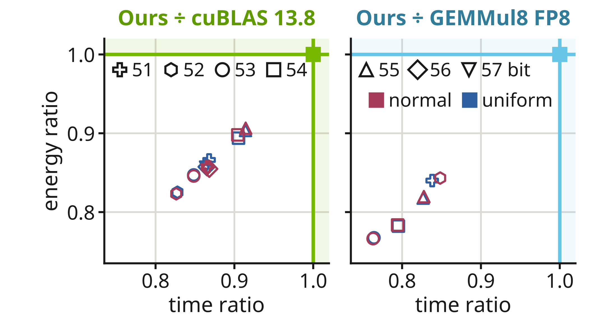

# Measurement conditions and accuracy

See the [README results](../README.md#measured-results) for the main DGEMM and
INT8 comparisons. This page gives their conditions and other measurements.
[Source records](Provenance/performance_sources.json) identify the measurements;
[figure records](Provenance/figures.json) identify images, sources and rendering.
The arXiv references in the README describe the methods, not these B300 results.

## Measurement figures and conditions

The measurements used 1 B300 SXM6 AC in an HGX B300 system, 1,100 W
power limit, clocks not fixed, CUDA 13.2, cuBLAS 13.8.0.4 FP64 emulation and
GEMMul8 v3.5.2 FP8 for these FP64 comparisons. The timed region includes encoding,
products and reconstruction. Method order rotates between repetitions; after
the first, 10–16 repetitions contribute to the reported medians. Ratios use
paired per-repetition times. Energy uses NVML cumulative-energy differences.

The common accuracy target is defined on 1,024 output elements on a 32x32 grid.
Against the exact inner product rounded to FP64, both the 95th-percentile and
maximum ULP errors must be at most native cuBLAS DGEMM's values on the same
sample in the same measurement. For the runtime comparison, each implementation
uses its fastest measured setting satisfying this target. This is a sampled
accuracy target, not a proof for all inputs or all output elements.

### DGEMM series

The [9-shape figure](../README.md#measured-results) and the fixed-53-bit routine
comparison use different runs and widths. Effective throughput counts 2MNK
divided by whole-call time, not Tensor Core instruction throughput. Paired ratios are
medians of per-round ratios, not ratios of rounded median times.

The base-13 bars use a fixed-53-bit comparison with the same kernel, GPU and
inputs; only the moduli/construction change. Its AWE/base-13 time ratios range from 0.87 to 0.92.
Product-count ratios of 66/75 for K<=4096 and 62/75 otherwise do not predict
runtime: scaling, encoding, loads and accumulators also contribute.

### Time and accuracy

The [time/error figure](../README.md#measured-results) uses uniform inputs in
[-1,1) and exponent-spread inputs `(rand - 0.5) * exp(phi * randn)` with phi=4.
It includes configurations that miss the native-FP64 target. Read its ULP axis
and native reference lines separately for each panel.

In the fixed-53-bit normal-input comparison, both AWE and base-13 failed the
accuracy target at 5120³ and are excluded from qualified speed results.
The phi=4 measurements needed at least 66 bits for the sampled target.
These earlier tests excluded NaN, Inf and subnormal inputs. Their sampled
accuracy does not extend to arbitrary data or all output elements.

### Time and energy at matched accuracy

At 8192³ with normal/uniform inputs, cuBLAS uses the same bit setting as AWE.
GEMMul8 FP8 uses its smallest timed modulus count with sampled p95 and maximum
ULP no worse than AWE at that width. Only qualified points are drawn.
This differs from selecting the fastest qualified competitor across all settings.
The plotting script lists excluded points separately and checks that the compute
and energy devices match. Its power cross-check uses NVML energy. The complete
dataset was not regenerated during release preparation.

## Exact INT8 measurements and hardware rates

The [README's exact INT8 result](../README.md#measured-results) uses 8192³ inputs
uniformly distributed over all signed byte values (−128…127). The call includes
encoding and reconstruction and took 1.231 ms. The FP16 comparator represents
INT8 values exactly, uses cuBLASLt with exact FP32 accumulation in chunks of
1,024 and sums in INT32. It took 1.299 ms; the median paired AWE/comparator ratio
was 0.948. AWE's FP4 products need no such chunks for K<=14,563.

A separate cuBLASLt NVFP4 test compared base-13 direct products with weights
(1,5,27) and difference planes. At 8192²×16384 and 16384³ with normal/uniform
inputs, product-time ratios were 0.66–0.67; whole-call ratios were 0.69–0.71.

In [the substitution figure](../README.md#measured-results), (i) is AWE NVFP4,
(ii) is GEMMul8 with alternative products and (iii) is cuBLAS FP16.
Replacing GEMMul8 v3.5.2's INT8 calls at 8192³ with normal inputs and 15 moduli
changed whole DGEMM time from 113.38 to 20.49 ms with bit-identical output.
Its FP8 path took 14.6 ms. See [DGEMM series](#dgemm-series) for the NVFP4 bar.

These experiments ran on 1 B300 in September–October 2026. The saved exact-INT8
source and library pass the device comparison, but its timing record has no
library SHA.
[The import record](Provenance/import_integer.json) preserves that missing link.

## Hardware and rate conventions

The INT8 6.0× ratio uses the Technical Brief's 0.15 POPS dense INT8 rate per
B300 GPU, half its rounded 0.30 POPS sparse value:
[NVIDIA Blackwell Architecture Technical Brief V2.1, Table 3](https://resources.nvidia.com/en-us-blackwell-architecture/blackwell-architecture-technical-brief).

## Measurements by engine

These are earlier measurements of the imported engines; the current frontend
has not been timed again. The records identify hardware, inputs, width, source
choice and any missing timing-to-library link.

### B300

[Measurement choices](Provenance/measurement_choices.json) lists the routine,
shape, distribution, public source choice and time for each October 2026 B300
measurement. The 8192³ normal DGEMM record uses 51 bits; see
[DGEMM series](#dgemm-series) for the fixed-53-bit comparison.

The small uniform ZHERK record has no identified width or library SHA.
The 49-bit method failed that small uniform target; the 8192 shape has its own 49-bit record. The 4096 ZSYRK,
ZHERK51 and CGEMM23 records lack timing-to-library links even where
saved builds match the included source. See [small complex evidence](Provenance/import_small_complex.json).

The real CRT comparison includes 51-bit 4096 normal at 1.888560061 ms, which
failed the target; 52 bits passed. At 8192³ normal, the 52- and 53-bit values were
11.932494882 and 12.293503101 ms; these and the 51-bit result in the record all passed.
The loaded-library links are in [import_real_crt.json](Provenance/import_real_crt.json).

### B200 / GB200

The saved Arm records include timings for DGEMM, S Level-3, CGEMM, exact INT8
and DTRSM. D/Z Level-3 timings in later Arm records have not been matched
to the public sources.
Standalone SGEMM has accuracy records only. The Z Level-3 correctness run used
a different Arm library from the saved ZGEMM library.

The recorded 23-bit K64 SSYRK at 4096³ with uniform input took 1.524963 ms
for the updated general CRT source, compared with 1.595572 ms for its reference.
The later fused candidate changed output hashes and is not included.
The recorded 53-bit DTRSM at M=4096, N=2048, block size 2048 took 2.453584 ms,
versus 2.317295 ms for native cuBLAS. It did not meet the native accuracy target
on every input. The 57-bit source has fixed-case accuracy records,
and the assembled public source still requires explicit selection.
[The GPU results](validation.md#results-and-known-failures) describe its later fixed-case checks.
See [K64 records](Provenance/import_k64.json) for exact scope and SHA values.

[K64 measurements](Provenance/k64_measurements.json) contains the Arm timing
values, source choices, file hashes and earlier output hashes. S Level-3 used
internal CUDA event timers. CGEMM used medians of paired host wall-clock times
for 1 synchronous call on device-resident operands, including copies inside
the call. Allocation, warmup, poisoning and reference checks were outside it.
All 4 CGEMM times use the 24-bit, 11-modulus Arm library (`c24_m11_gemm`) and
correctly-rounded sample counts rather than the later native p95/max rule.
