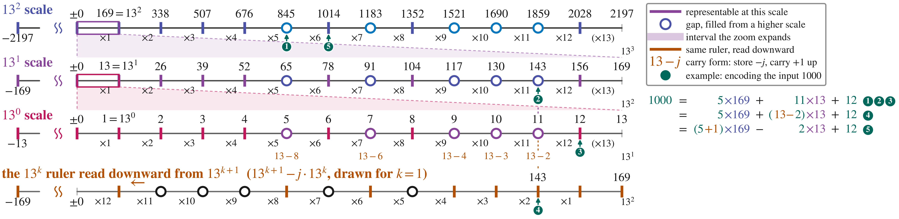
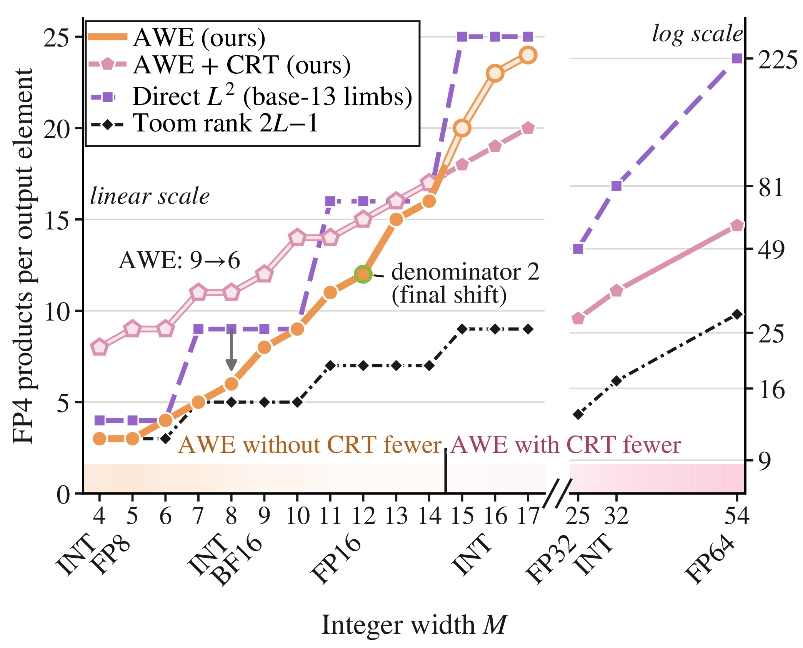
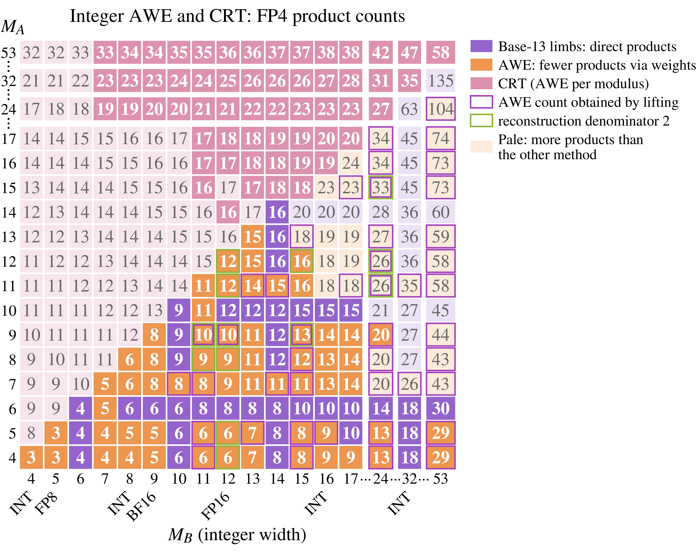

# Integer representations

The [README](../README.md#why-fp4-and-what-awe-reduces) introduces AWE and the
[53-bit example](../README.md#a-53-bit-modulus-set). This guide defines the
representations and the bounds used to interpret the catalogue.

## Terms

A **limb** is a component of an integer representation. In the base-13 form,
integers use `2 * (E2M1 value) + 13n`; division by 2 is an exponent adjustment.
Adjustments by ±13 are **carry** operations. A value absent from storage can
use a sum such as `5 = 4 + 1`.

A **plane** is a linear combination of limbs used in a product. **Coverage**
is the symmetric interval ±X represented by a construction. M denotes integer
width and w denotes weights.

The integer storage set for doubled E2M1 is
`S = {0, ±1, ±2, ±3, ±4, ±6, ±8, ±12}`. A valid encoding keeps all stored planes
in S. The [catalogue schema](../AWE/Solutions/schema.md) specifies weights,
coefficient vectors, encoding lookup tables and correction domains.

Ozaki scheme I combines scaled low-precision components. Scheme II reconstructs
integer products from residues with CRT. Integer constructions without CRT are
also included in the catalogue.

### Base-13 storage and carry

The base-13 representation is described in [arXiv:2608.06812](https://arxiv.org/abs/2608.06812).

The example follows 1000 through 3 base-13 scales. Values absent from 1
scale's FP4 storage set use a carry from the next scale.

### FP4 product counts by integer width

<table>
  <tr>
    <td width="49.5%" valign="top"></td>
    <td width="50.5%" valign="top"></td>
  </tr>
</table>

The left plot compares FP4 product counts by integer width, with a separate logarithmic
axis for wider inputs. Each square cell in the right map describes an integer-width
pair M_A × M_B: the lower triangle shows direct constructions, and the upper
triangle shows CRT constructions with the operands exchanged. These construction
counts exclude encoding, memory traffic and reconstruction time; open either image
for the full-size labels.

## Reconstruction and accumulation bounds

For real inputs quantized to integers of magnitude at most `q = 2^bits - 1`,
CRT reconstruction requires `P > 2*K*q*q`. The last admissible integer K is
`floor((P - 1) / (2*q*q))`, where P is the product of the selected moduli.
Complex output components sum 2 real products and use `P > 4*K*q*q`.
The original complex plans also retain their `P / 4 / K / q >= q` check.
Their ZL8 path calls `zl8_check_tables`; the 51-bit HERK build does not enable
the alternate `L8_CRT5` path. These are source checks, not GPU correctness tests.
The [coverage record](Provenance/coverage_bounds.json) and
[additional engine tables](Provenance/additional_engines.json) give the products.

CRT coverage is only 1 condition. Accumulator exactness, payout bias, table
geometry, scale representation and rounding impose separate limits.
[Host table checks](Provenance/table_bounds.json) test these premises independently.
A larger mathematical K bound does not extend the [API's accepted K](api.md).
Real guards compare by successive divisions of `P - 1` after validating dimensions
and width. CPU checks cover equality and adjacent values. `Tools/table_bounds.py`
checks the real table premises for every K from 1 through 16384 without CUDA.
The K64 DTRSM57 product has 129 bits; its host comparison uses all 5 words.
This integer bound does not guarantee floating-point solve accuracy.

INT8 GEMM uses direct reconstruction. The engine checks FP32 accumulation
bounds for each call and uses an exact integer kernel when those bounds fail.
Its public K bound also keeps `K*128^2` within INT32. The floating-point interfaces
quantize each input row or column with a shared binary scale, reconstruct integer
products, then rescale. Exactness applies to the quantized operands, not arbitrary
original floating-point inputs.

The retained mathematical reports describe [pair-plane reconstruction](../AWE/Solutions/SIX_PRODUCT.md),
[storage caps](../AWE/Solutions/SOLUTIONS_intN.md#k-limits-by-storage-cap-added-2026-08-17)
and [search scope](../AWE/Solutions/PLANE.md#search-cutoffs-explicit-scope-restrictions).
Their tables and corrections remain at those locations; they are not duplicated here.
