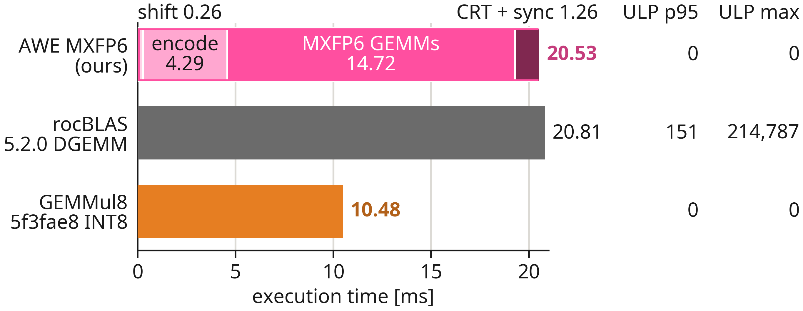
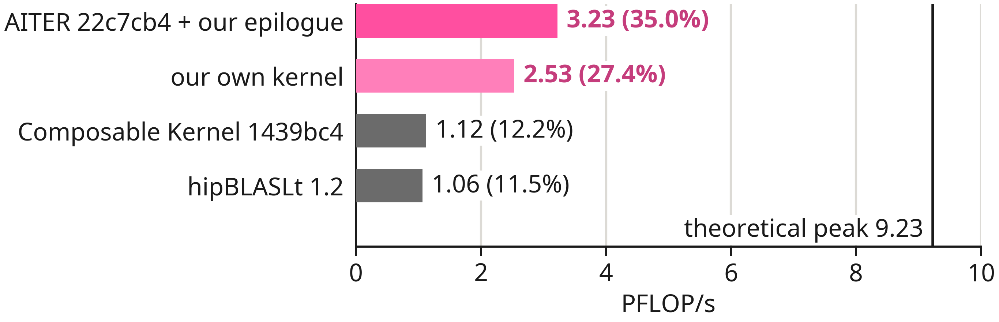

# AMD Instinct MI350X: FP64 GEMM on MXFP6 Matrix Cores

The MI350X runs MXFP6 at the same rate as MXFP4 ([9.2 PFLOP/s each](https://www.amd.com/en/products/accelerators/instinct/mi350/mi350x.html)),
so this engine multiplies FP6 (E2M3) values instead of FP4 ones.

One engine: `HIP-Inline/GEMM/GFX950_K128/D53_MXFP6_CRT/` computes C = A B in FP64 (8192 x 8192 x
8192, column-major, alpha = 1, beta = 0) from exact integer products on the MXFP6 (E2M3) Matrix Cores
of gfx950. Each input row of A and column of B is scaled to a 53-bit integer grid, encoded as residues
modulo 19 moduli (30 FP6 product planes, [table](HIP-Inline/GEMM/GFX950_K128/D53_MXFP6_CRT/table_d53_k8192.h)),
multiplied by 31 MXFP6 GEMM launches whose epilogue folds the FP32 accumulator into uint16 residues,
and reconstructed with the Chinese remainder theorem (CRT) and one rounding to binary64. The output equals the exactly rounded
dot product of the quantized inputs.

The 19 moduli: 17, 19, 23, 25, 27, 29, 31, 32, 37, 41, 43, 47 and 49 need 1 FP6 product each, 121 needs
2, and 1223, 1231, 1249, 1279 and 1283 need 3. The three-product moduli are chosen so that every FP6
value of their products has magnitude 36 or less (E2M3 values times 8), which keeps K = 8192 in one
launch (see [the engine page](HIP-Inline/GEMM/GFX950_K128/D53_MXFP6_CRT/README.md)).

## Build and run

Requires ROCm 7.2 (hipcc, the ROCm clang assembler, rocBLAS; hipBLASLt for the benchmark) and
CMake 3.31.

```sh
cmake -S . -B Build-MI350X -DAWE_BACKEND=MI350X
cmake --build Build-MI350X --parallel 2
ctest --test-dir Build-MI350X --output-on-failure          # CPU test of table, residues, CRT, rounding
Build-MI350X/Bin/awe_mxfp6_check --full                    # GPU: exact samples, rocBLAS bound, inputs unchanged
Build-MI350X/Bin/awe_mxfp6_bench --hipblaslt               # GPU: timings against rocBLAS and hipBLASLt
```

With CMake 3.21 to 3.30, configure the engine directory on its own instead of the first line:
`cmake -S Platforms/AMD/HIP-Inline/GEMM/GFX950_K128/D53_MXFP6_CRT -B Build-MI350X`. It gives the same
targets and output paths.

The kernel code object `Build-MI350X/Lib/awe_mxfp6_modular.co` is assembled from
`AITER/modular.s` ([origin and changes](HIP-Inline/GEMM/GFX950_K128/D53_MXFP6_CRT/THIRD_PARTY.md)).
`-DAWE_ENABLE_GPU_TESTS=ON` registers the GPU check with CTest. From C++, construct
`awe_mxfp6::Dgemm8192 plan(stream, module_path)` and call `plan.run(a, b, c, lda, ldb, ldc)`
([plan.h](HIP-Inline/GEMM/GFX950_K128/D53_MXFP6_CRT/plan.h)).

## Measured result

<a href="../../Figures/amd-mi350x-dgemm-times.png"></a>

> [!NOTE]
> The figure was measured with the 29-product table (44 launches at K = 8192; the second-to-last step
> in the table below). The 30-product table that the engine uses at 8192³, timed with
> `awe_mxfp6_bench` against rocBLAS DGEMM in the same runs (median of 11 calls; saving = 1 - median of
> the paired time ratios):
>
> | Calls | Runs | AWE (ms) | rocBLAS (ms) | AWE saves |
> |:---|---:|---:|---:|---:|
> | 2 s pause added between calls | 2 | 19.7–19.8 | 20.5–20.7 | 4.5% |
> | back to back (the default of `awe_mxfp6_bench`) | 14 | 18.0–18.2 | 18.7–18.9 | 3.2–4.4% |

The engine passes the accuracy criterion in all 3 runs, and GEMMul8 passes it too. GEMMul8 was built
separately and is not part of this repository. With the 30-product table the engine also passes the
CPU test and `awe_mxfp6_check --full` (1,024 sampled outputs bit equal, ULP errors 0; every output
within the bound).

<details><summary>Conditions and checks</summary>

1 MI350X (gfx950), ROCm 7.2.0, 8192³, uniform inputs in [-1, 1) on a 53-bit grid, FP64 inputs resident
on the device to FP64 output. Libraries: rocBLAS 5.2.0, hipBLASLt 1.2, GEMMul8 commit 5f3fae8 (INT8,
15 moduli, fast), Composable Kernel commit 1439bc4, AITER commit 22c7cb4. Median of 11 timed calls
after 3 warm-ups, in 3 independent runs of a measurement program that also ran GEMMul8 and checked
every output on the CPU between calls, method order rotated. Accuracy
criterion: on 1,024 sampled outputs, the 95th-percentile and maximum ULP errors against the exact dot
product rounded to binary64 are no worse than rocBLAS DGEMM on the same inputs.

The CRT + sync bar is CRT 1.20 ms and 0.06 ms of host synchronization outside the GPU events. In each
of the 3 runs, the timed build compared all 67,108,864 outputs 15 times with an independent reference
of the quantized products (bit equal) and with rocBLAS (within the quantization plus rounding bound),
and 9,186 outputs were checked against the exact dot product of the original inputs.
`awe_mxfp6_check` in this repository checks 1,024 sampled outputs bit for bit against the exactly
rounded dot product of the quantized inputs, applies the accuracy criterion to them, and with
`--full` checks every output against rocBLAS within that bound.

</details>

| Change | Stage | Whole time (ms) | Saved (%) |
|:---|:---|---:|---:|
| Start: our own MXFP6 GEMM kernel (figure below) | | 26.15 | |
| + packed encoding table | encode | 25.48 | 2.6 |
| + branch-free encoding, fewer register spills in the GEMMs | encode, GEMMs | 23.70 | 7.1 |
| + AITER `22c7cb4` kernel, residue update in its epilogue | MXFP6 GEMMs | 23.14 | 2.5 |
| + encoder writes the GEMM input directly | encode | 22.66 | 2.7 |
| + one encoding table (432 bytes) in shared memory | encode | 22.18 | 1.8 |
| + higher occupancy (more wavefronts per SIMD unit) | encode | 21.88 | 1.7 |
| + addresses in shared memory | encode | 21.56 | 1.2 |
| + less shared memory | CRT | 21.14 | 1.6 |
| + fewer moduli (19) | all | 20.64 | 2.6 |
| + reordered reads | encode | 20.53 | 0.7 |
| + moduli that keep K = 8192 in one launch (30 products, 31 launches) | MXFP6 GEMMs | 19.69–19.83 | 4.4 |
| rocBLAS 5.2.0 DGEMM, same sessions | | 20.47–20.95 | |

Whole 8192³ DGEMM time after each change; each + row adds one change to the row above, and the last
one is the engine in this repository. Saved: share of the time that change alone saved, against the
version without it run in the same session. The last row was timed with `awe_mxfp6_bench` and a 2 s
pause added between calls; in that session the row above took 20.63 to 20.69 ms and rocBLAS 20.47 to
20.70 ms.

<a href="../../Figures/amd-mi350x-mxfp6-gemm.png"></a>

The MXFP6 GEMM alone at 8192³ with FP32 output: 2MNK over the kernel time, against the 9.23 PFLOP/s
theoretical peak. Our own kernel is the one at the start of the steps above and is not in this
repository. We changed the epilogue of AITER's kernel to store FP32, and the engine's 31
launches run the same kernel with the residue update in that epilogue
([changes](HIP-Inline/GEMM/GFX950_K128/D53_MXFP6_CRT/THIRD_PARTY.md)).

## Limits

> [!WARNING]
> Only M = N = K = 8192, FP64, column-major, no transpose, alpha = 1, beta = 0.

> [!NOTE]
> - About 5.8 GB of device memory per plan, in addition to A, B and C.
> - Inputs with NaN or infinity are rejected (the call throws).
> - A value 2^-e times the largest of its row of A or column of B keeps about 53 - e significant bits.
> - The accuracy criterion is sampled, not a proof for all inputs.
> - Smaller sizes are slower than rocBLAS DGEMM. A build of the same code with the matrix size changed
>   (not in this repository), timed back to back, took 1.28 to 1.53 times as long as rocBLAS at 4096³
>   (AWE 3.5 ms) and 1.15 to 1.18 times as long at 8192 x 8192 x 4096 (AWE 10.8 to 11.0 ms). At
>   K = 4096 every product fits in one launch and the 29-product table is the faster one, so
>   `table_select.h` uses it there.

<details><summary>Details</summary>

- The operand layout, the segment schedule and the kernel grid are written for the 8192 shape. The
  modulus set is exact for K <= 8192 at 53 bits.
- The 5.8 GB are 3.2 GB of FP6 operand planes and 2.6 GB of residues.
- Each row of A and column of B shares one power-of-two scale.
- With ROCm 7.2.0 and the flags in its CMakeLists.txt, the 6 HIP kernels of this source compile to the
  same gfx950 instructions as the measured build, and `AITER/modular.s` assembles to the same code
  object except for the linker version string. The host code launches the same kernels in the same
  order, with the same argument values apart from device addresses.

</details>
