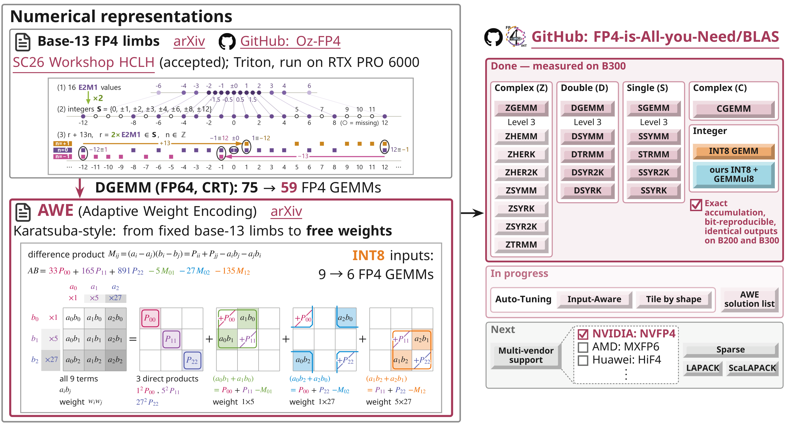
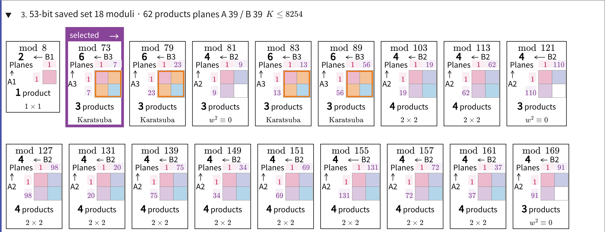
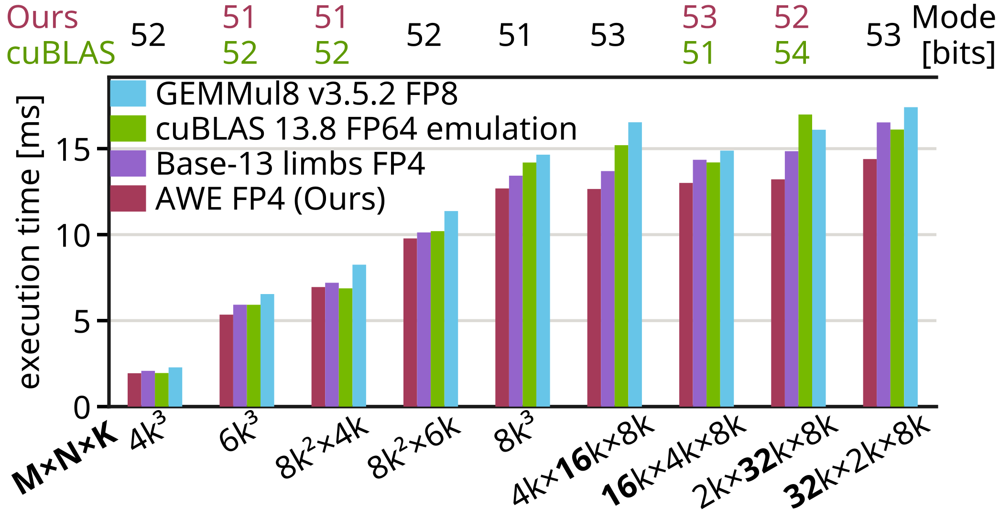
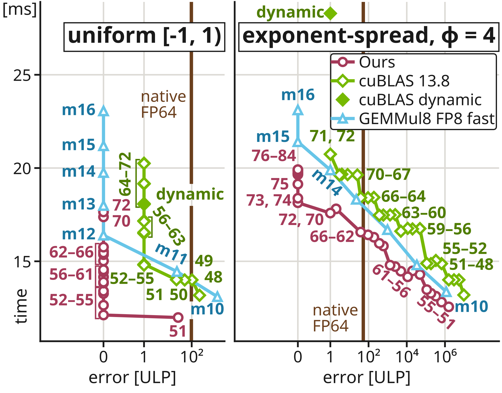
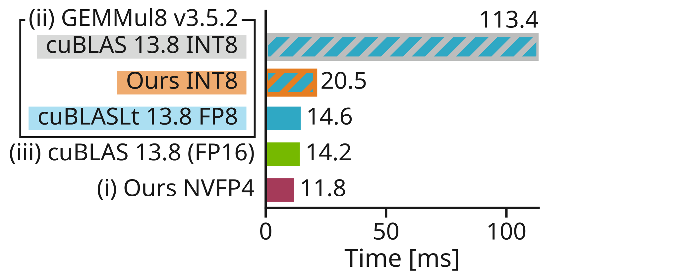

# FP4 BLAS

Exact integer matrix products on FP4 Tensor Cores, and BLAS routines built on them.

> [!WARNING]
> The public API was tested on B300 and B200, and known failures remain. See the [GPU test results](Docs/validation.md#results-and-known-failures).

## Overview

<a href="Figures/fp4-overview.png"></a>

> [!NOTE]
> Research status as of 2026-10-02. Current support is listed [below](#supported-operations); outputs compared across B300 and B200 are in the [GPU test results](Docs/validation.md#common-inputs-across-gpus).

## Why FP4, and what AWE reduces

B300 raised FP4 throughput but cut FP64 and INT8 sharply (see [Hardware](#hardware)). FP64 and FP32 matrix products can be built from exact integer products (the Ozaki schemes), so exact integer products on FP4 Tensor Cores carry FP4 throughput over to FP64, FP32 and integer GEMM.

Our earlier base-13 limbs ([arXiv:2608.06812](https://arxiv.org/abs/2608.06812), [Oz-FP4](https://github.com/FP4-is-All-you-Need/Oz-FP4)) store each integer as limbs that FP4 (E2M1) can hold, with ±13 carries for the values FP4 lacks. The radix is fixed and every pair of limbs is multiplied, so the number of FP4 GEMMs grows with the square of the limb count, and the limb magnitudes limit how long a dot product can be accumulated exactly.

AWE ([arXiv:2609.24519](https://arxiv.org/abs/2609.24519)) improves on this. It chooses the limb weights freely and multiplies linear combinations of limbs (planes) instead of every limb pair, so an exact product needs fewer FP4 GEMMs. The [AWE site](https://fp4-is-all-you-need.github.io/AWE/) lists every construction.

<table>
  <thead>
    <tr><th rowspan="2">Family</th><th rowspan="2">Inputs</th><th colspan="2">FP4 GEMMs for 1 exact product</th><th rowspan="2">Ratio</th></tr>
    <tr><th>Base-13 limbs<br>(prior work)</th><th>AWE</th></tr>
  </thead>
  <tbody>
    <tr><td rowspan="3">Direct</td><td>INT8 × INT8</td><td align="center">9</td><td align="center">6</td><td align="center">1.5×</td></tr>
    <tr><td>INT4 × INT8</td><td align="center">6</td><td align="center">4</td><td align="center">1.5×</td></tr>
    <tr><td>FP16 significand</td><td align="center">16</td><td align="center">12</td><td align="center">1.3×</td></tr>
    <tr><td>Residue systems<br>(K = 16,384)</td><td>FP64 significand</td><td align="center">75</td><td align="center">59</td><td align="center">1.3×</td></tr>
  </tbody>
</table>

Ratio = base-13 count ÷ AWE count. These are construction counts, not timings. The [construction guide](Docs/representations.md) explains carries, planes and product counts by width.

## A 53-bit modulus set

<a href="Figures/modulus-set-53bit-awe.png"></a>

18 moduli, 62 products, 39 planes per operand and 23 accumulators, exact for K ≤ 8254.

[Open this set in the AWE site](https://fp4-is-all-you-need.github.io/AWE/?lang=en&precision=fp64&b=53&K=8192&crt=1&modset_id=awems1_5b05738257bbabf8901c9dfaa2c8b7d03469ce483316bd6e8f9b0b46197e5757&view=main&slot=1&swap=0&open.main=1).

## Hardware

Nominal maximum rates of an 8-GPU HGX system. B200 targets `sm_100a`; B300 targets `sm_103a`.

| Format | HGX B200 | B300 / B200 | HGX B300 |
|---|---:|:---:|---:|
| FP64 | 296 TFLOP/s | $\color{red}{\searrow\ \approx 1/30}$ | 10 TFLOP/s |
| INT8 Tensor Core | 36 POPS | $\color{red}{\searrow\ 1/24}$ | 1.5 POPS |
| FP8 Tensor Core | 36 PFLOP/s | $\rightarrow\ 1.0\times$ | 36 PFLOP/s |
| FP4 Tensor Core | 72 PFLOP/s | $\color{blue}{\nearrow\ 1.5\times}$ | 108 PFLOP/s |

<details>
<summary>Source</summary>

[NVIDIA HGX specifications](https://www.nvidia.com/en-au/data-center/hgx/). INT8, FP8 and FP4 are dense rates; INT8 and FP8 are half the listed sparse values. These are theoretical rates for 8 GPUs, not measured speedups; the results below use 1 B300 GPU. [Values and calculations](Docs/Provenance/hardware_rates.json).

</details>

## Measured results

Measured on 1 B300 in September–October 2026 with the imported engines, before the current frontend.

**DGEMM.** In a fixed-53-bit series, 8192³ with normal inputs took **11.8 ms**, a median time ratio of **0.832** to the fastest qualified competitor (cuBLAS 13.8 FP64 emulation at 51 bits).

<table>
<tr>
<td><a href="Figures/dgemm-shape-times-fp4-legend.png"></a></td>
<td><a href="Figures/dgemm-time-accuracy.png"></a></td>
</tr>
</table>

Each bar uses the fastest AWE width that meets the accuracy target (51–53 bits).

At comparable ULP errors in both panels' overlapping ranges, AWE ("Ours" in the figure) takes less time than cuBLAS 13.8 and GEMMul8 FP8 fast; the figure includes settings up to 84 bits that this release does not expose.

**Exact INT8 × INT8.** 8192³ reached **893 effective TOPS**, 6.0× the [0.15 POPS INT8 reference](Docs/performance.md#hardware-and-rate-conventions). Replacing GEMMul8's INT8 products sped up 8192³ DGEMM by **5.53×** with bit-identical output.



The NVFP4 bar is from a separate 53-bit comparison. The INT8 engine is included; the GEMMul8 replacement is not.

More: [conditions and accuracy](Docs/performance.md#measurement-figures-and-conditions) · [time and accuracy](Docs/performance.md#time-and-accuracy) · [time and energy](Docs/performance.md#time-and-energy-at-matched-accuracy) · [INT8 details](Docs/performance.md#exact-int8-measurements-and-hardware-rates) · [accuracy limits](Docs/validation.md#results-and-known-failures)

## Supported operations

Each cell is B300 (K96), then B200/GB200 (K64): ✅ measured engine included · ☑ included, not compared with a measured performance record · ○ source included, explicit selection required · blank: absent.

| Type | GEMM | SYMM | HEMM | SYRK | HERK | SYR2K | HER2K | TRMM | TRSM |
|---|---|---|---|---|---|---|---|---|---|
| Z | ☑ ☑ | ☑ ☑ | ☑ ☑ | ✅ ☑ | ✅ ☑ | ☑ ☑ | ☑ ☑ | ✅ ☑ | |
| D | ✅ ☑ | ☑ ☑ | | ✅ ☑ | | ☑ ☑ | | ✅ ☑ | &emsp;○ |
| S | ✅ ○ | ☑ ○ | | ✅ ☑ | | ☑ ○ | | ✅ ○ | |
| C | ✅ ✅ | | | | | | | | |
| INT8 | ☑ ☑ | | | | | | | | |

> [!NOTE]
> Supported forms: column-major, no transpose, lower triangle, left side, non-unit diagonal, alpha = 1, beta = 0. Defaults and explicit engine selection are in the [API guide](Docs/api.md); known failures are in the [GPU test results](Docs/validation.md#results-and-known-failures).

## Build and minimal use

Requirements are in the [build guide](Docs/build.md).

```sh
cmake -S . -B Build-K96 -DAWE_BACKEND=K96 -DAWE_NVCC="$HOME/opt/cuda-13.2/bin/nvcc"
cmake --build Build-K96 --parallel 2
ctest --test-dir Build-K96 --output-on-failure
```

Use `-DAWE_BACKEND=K64` for B200. Keep the frontend and engine libraries together in `Build-K96/Lib/`. GPU tests are off by default; see [validation](Docs/validation.md).

<details>
<summary>Minimal C call with ready device arrays on B300</summary>

```c
#include <AWE/awe.h>
awe_descriptor d;
awe_descriptor_init(&d, AWE_DGEMM);
d.m = d.n = d.k = 4096;
d.lda = d.ldb = d.ldc = 4096;
awe_plan *plan = NULL;
awe_status status = awe_plan_create(&plan, &d, NULL);
if (status == AWE_SUCCESS) {
    status = awe_dgemm(plan, a, b, c);
    /* Check status and awe_last_error() here. */
    awe_plan_destroy(plan);
}
```

Compile with `-IInclude -LBuild-K96/Lib -lawe`.

</details>

## Repository structure

| Location | Responsibility |
|---|---|
| `API/`, `Include/AWE/`, `Routines/` | C API, dispatch and module loading |
| `Platforms/NVIDIA/CUDA-Inline/<Routine>/<SM_K>/<Engine>/` | Imported CUDA/PTX implementations; selected by default |
| `Platforms/NVIDIA/CUDA-Template/GEMM/` | Shared traits for d17/d18; used for new development |
| `Platforms/NVIDIA/CUDA-Common/` | Shared host options and Level-3 support kernels |
| `AWE/Solutions/` | Weights, planes, reconstruction and coverage checks |
| `AWE/CodeGen/`, `AutoTuning/`, `Sparse/` | Not implemented yet: constant generation, automatic selection, sparse routines |
| `Figures/`, `Docs/`, `Tests/`, `Tools/`, `CMake/` | Figures, documentation, validation and build support |
| `Legacy/<date>/` | snapshots of earlier versions ([inclusion table](Docs/Provenance/README.md#legacy-data)) |

[Architecture and source comparisons](Docs/architecture.md).

## Citation

```bibtex
@misc{hayashi2026awe,
  title         = {AWE: Adaptive Weight Encoding for Exact Integer Matrix Products with Fewer GEMMs on FP4 Tensor Cores},
  author        = {Hayashi, Shun{-}ichiro and Mukunoki, Daichi and Hoshino, Tetsuya and Katagiri, Takahiro},
  year          = {2026},
  eprint        = {2609.24519},
  archivePrefix = {arXiv},
  primaryClass  = {cs.MS},
  url           = {https://arxiv.org/abs/2609.24519}
}
```

## License

[MIT License](LICENSE).
